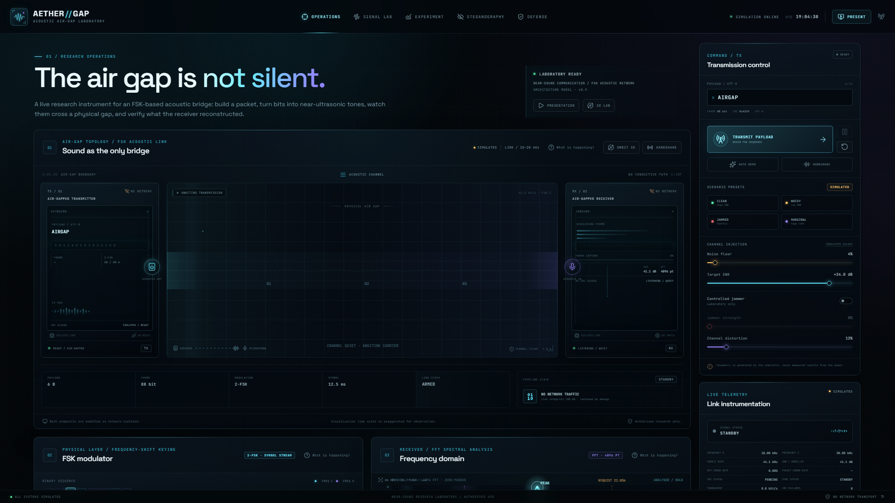
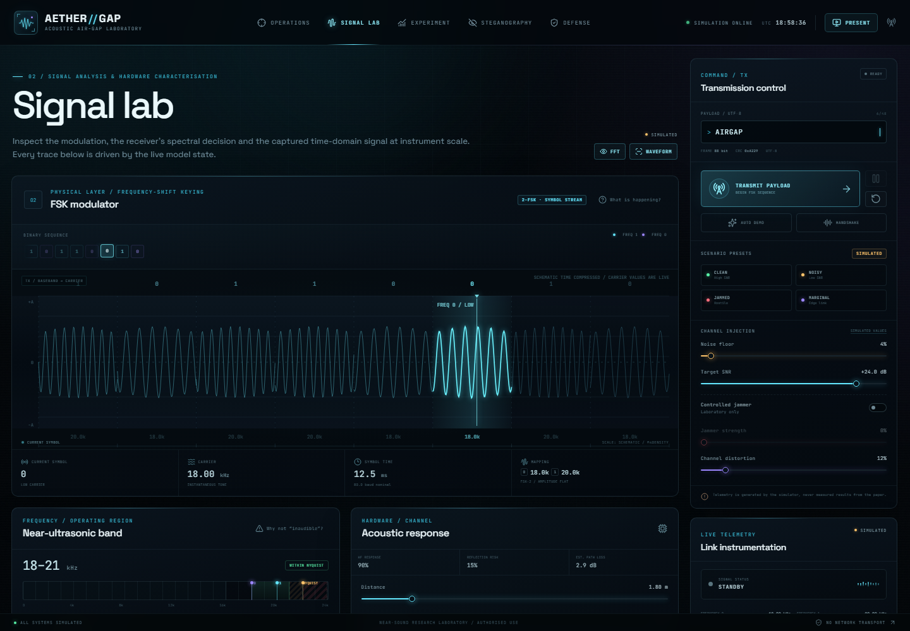
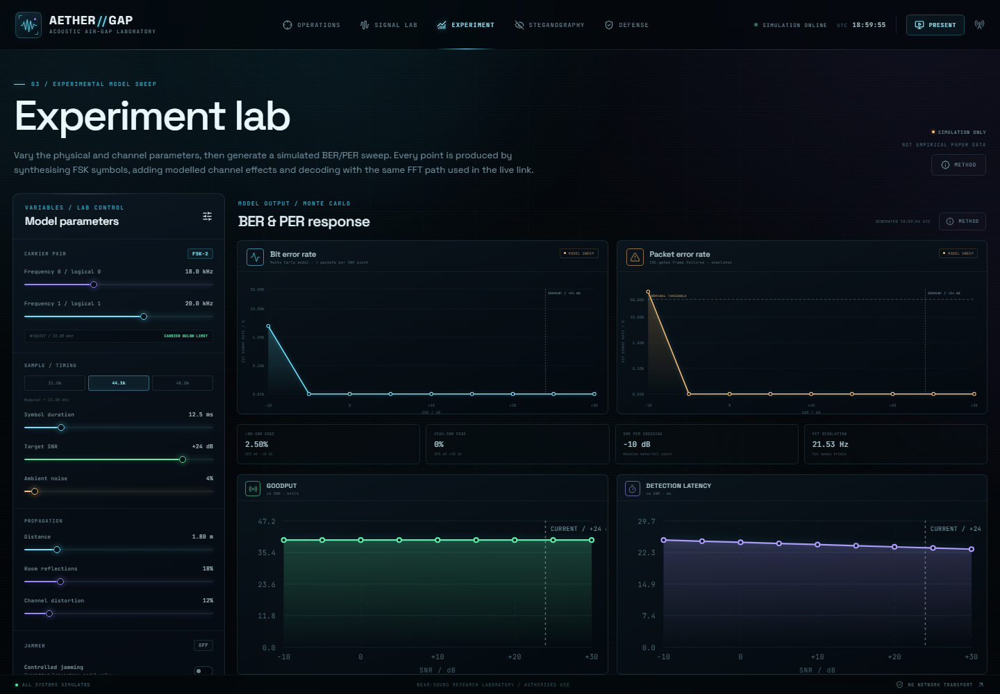
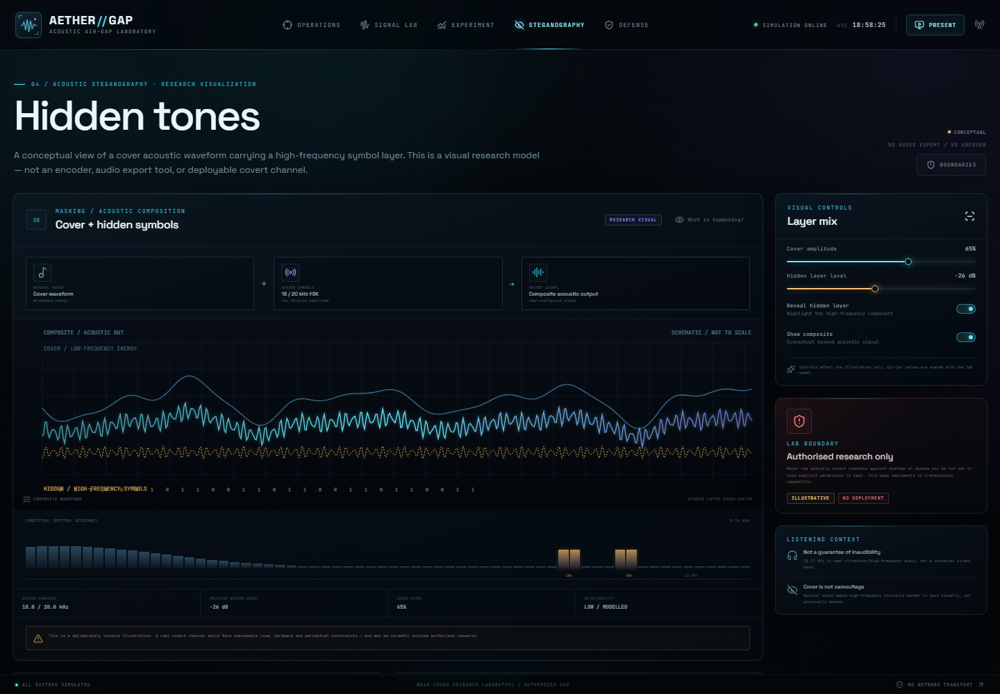
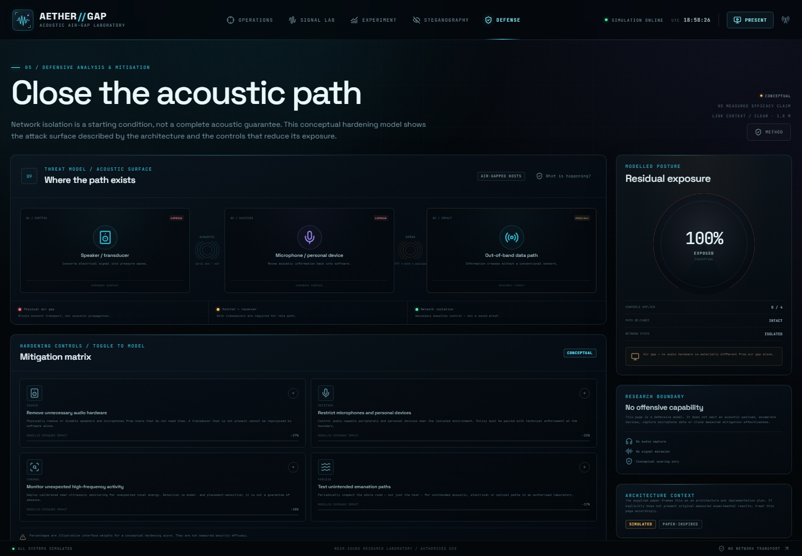
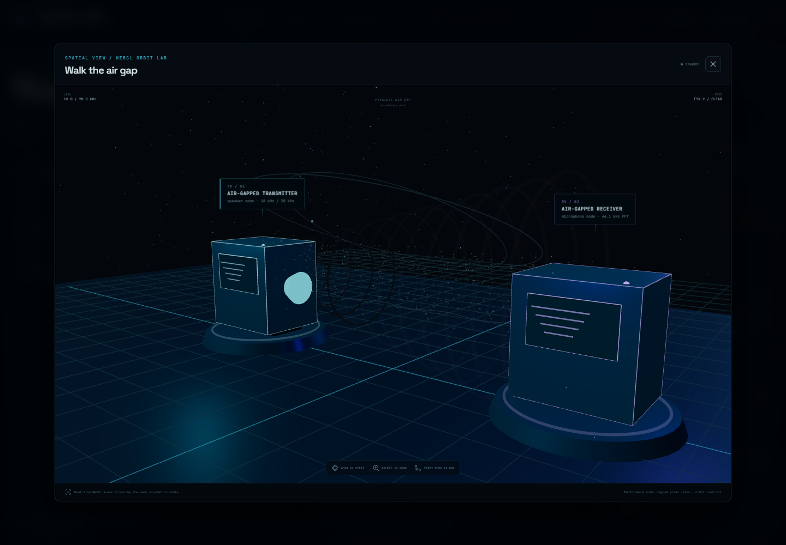
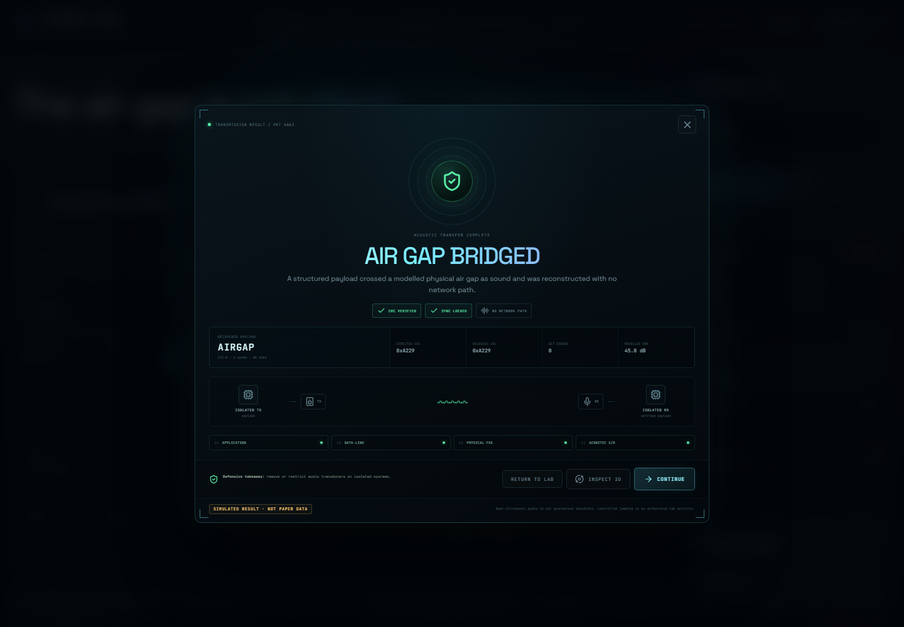
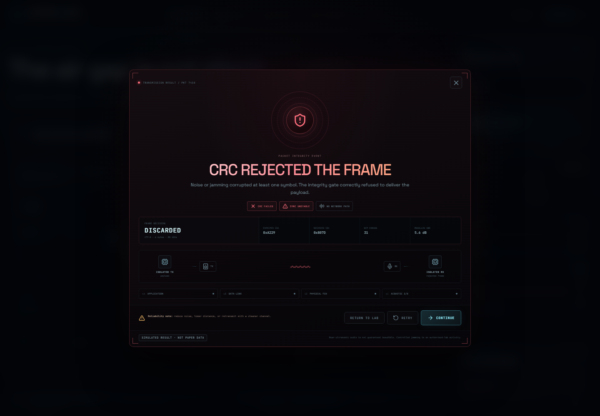
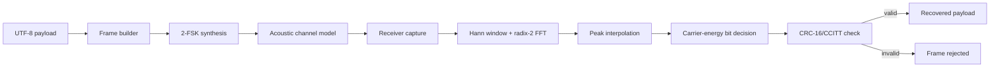

<div align="center">

# AETHER//GAP

### Acoustic Air-Gap Laboratory

**A cinematic, state-driven simulation of an FSK acoustic air-gap bridge — from payload to bits, tones, air, microphone, FFT, CRC and recovered data.**

[Quick start](#quick-start) · [Feature tour](#feature-tour) · [How the simulation works](#how-the-simulation-works) · [Analysis](#analysis) · [Scientific boundary](#scientific-boundary)




</div>

---

## Overview

**AETHER//GAP** is an interactive research instrument for exploring how data could cross a physical air gap as sound rather than as a network packet. It is built as a laboratory, not a landing page: every waveform, spectrum, bit decision, CRC result and experiment point is generated by the same local model that drives the interface.

The experience follows one complete signal path:

```text
UTF-8 payload
   → framed bits (preamble + length + payload + CRC-16)
   → 2-FSK symbols
   → modelled acoustic channel (distance, noise, reflections, hardware, jamming)
   → receiver capture
   → Hann-windowed FFT
   → carrier-energy comparison
   → recovered bits
   → CRC-16/CCITT verification
   → accepted payload or rejected frame
```

The project is deliberately honest about what it is. It does **not** reproduce measured results from a paper, open a microphone, emit audio, or claim that 18–21 kHz is universally inaudible. It is a transparent, inspectable model of an architecture — useful for teaching, interface research, DSP demonstration and security discussion.

### What this is

- A real, browser-native FSK simulation with deterministic noise and demodulation.
- A visual explanation of packet framing, spectral detection and CRC-gated integrity.
- A configurable channel laboratory for exploring SNR, distance, reflections, hardware response and jamming.
- A synthetic BER/PER experiment workbench.
- A conceptual defence and steganography visualisation.
- A responsive, presentation-ready interface with a live 3D orbit view.

### What this is not

- Not a real acoustic modem or a deployed covert channel.
- Not empirical evidence, a peer-reviewed measurement, or a reproduction of paper data.
- Not a tool for intercepting, decoding or disrupting real communications.
- Not a guarantee that high-frequency audio is inaudible, secure or undetectable.
- Not an encoder, audio exporter or microphone capture application.

---

## Feature tour

### 01 · Operations

The main laboratory. The air-gap stage shows isolated TX and RX devices, the acoustic channel, live symbol activity and the receiver’s spectral state. Around it sit the FSK modulator, FFT analyser, oscilloscope, protocol stack, data-flow timeline and packet/CRC inspector.

- Live payload entry with UTF-8 byte and frame-bit counts.
- Transmit, pause and reset controls.
- Clean, noisy, jammed and marginal scenario presets.
- Live CRC, sync status, BER, SNR, throughput and packet state.
- Handshake overlay and presentation mode.
- “What is happening?” explanations for each major concept.



### 02 · Signal Lab

A closer instrument view of the physical layer.

- Full-width FSK waveform with per-symbol frequency annotations.
- Binary sequence view and current-symbol readout.
- Near-ultrasonic band panel with an explicit “why not inaudible?” explanation.
- Modelled speaker and microphone response.
- Frequency-domain view with carrier peaks and noise floor.
- Oscilloscope and packet-assembly panels.
- Sample-rate, carrier, symbol-time and channel controls.



### 03 · Experiment

A synthetic model sweep, not a measurements page.

- BER and PER curves across −10 to +30 dB SNR.
- Throughput, detection latency, FFT margin and sync stability.
- Nine SNR points with four trials per point.
- Every point runs the same FSK synthesis, noise injection and FFT decision path as the live link.
- Current operating point marked on each chart.
- Explicit “simulation only / not empirical paper data” labelling.



### 04 · Steganography

A conceptual visualisation of a cover acoustic waveform carrying a high-frequency symbol layer.

- Cover amplitude and hidden-layer level controls.
- Composite and hidden-layer waveform views.
- Conceptual spectral occupancy.
- Explicit boundaries: visual research model, not an encoder, not a deployable covert channel.
- “Not a guarantee of inaudibility” and “cover is not camouflage” notes.



### 05 · Defense

A defensive analysis of the acoustic path.

- Threat path from speaker/transducer to microphone/personal device to out-of-band data path.
- Toggleable mitigation matrix with illustrative interface weights.
- Residual-exposure model and applied-control count.
- Research boundary: conceptual hardening only, no offensive capability, no measured efficacy claim.
- Explicit note that air gaps are materially different from network air gaps.



### 06 · 3D Orbit Lab

A separate WebGL view of the same simulation state.

- Transmitter and receiver nodes with live beacons and screen tint.
- Acoustic wavefronts and particles that respond to transmission, bit state and jamming.
- Projected TX/RX labels that track the 3D nodes in screen space.
- Orbit, zoom and pan controls.
- Camera auto-fit for wide and portrait stages.
- Render loop only runs while the modal is open; pixel ratio is capped for performance.

### 07 · Result overlays

<table>
  <tr>
    <td width="50%">
      
      <br /><sub><b>CRC valid</b> — payload recovered, sync locked.</sub>
    </td>
    <td width="50%">
      
      <br /><sub><b>CRC rejected</b> — corrupted frame is discarded, not delivered.</sub>
    </td>
  </tr>
</table>

### 08 · Presentation mode

A distraction-free walkthrough for demos and talks.

- Auto-starts a transmission.
- Hides editing chrome and mode navigation.
- Keeps the live air-gap stage and telemetry.
- `Esc` exits when no other overlay is open.

---

## How the simulation works

### Signal pipeline



### Frame format

| Field | Size | Notes |
|---|---:|---|
| Preamble | 16 bits | Fixed synchronization pattern |
| Length | 8 bits | Payload length in bytes |
| Payload | 8 × n bits | UTF-8 bytes, capped at 48 characters |
| CRC | 16 bits | CRC-16/CCITT over length + payload |

The default payload `AIRGAP` produces **88 bits**: 16 preamble + 8 length + 48 payload + 16 CRC.

### Transmitter

- Binary FSK with two configured carriers (`f0` for `0`, `f1` for `1`).
- Symbol duration is configurable from 4 to 50 ms.
- Each symbol is synthesised at the selected sample rate with a deterministic phase offset.
- The transmitter waveform and the received waveform are kept separately so the UI can show both clean and channel-affected signals.
- No audio is played. The samples exist only inside the model.

### Channel model

The receiver path is not a decorative animation. Each symbol is passed through a modelled channel:

- **Distance loss** — gain falls with distance.
- **Speaker and microphone response** — configurable efficiency and a high-frequency penalty.
- **Thermal/room noise** — Gaussian noise derived from the effective SNR, with occasional impulsive events at high noise settings.
- **Multipath** — a delayed echo whose strength depends on reflections and distortion.
- **Clock/multipath drift** — a small frequency-offset component at higher distortion.
- **AGC** — boosts signal and noise together.
- **OS/audio processing** — a `tanh` saturation model.
- **Jamming** — centre tone, swept tone, carrier bleed and noise, scaled by jammer strength.

Noise is deterministic for a given `(seed, symbol index)`. That means the live FFT, the bit decision and the final CRC all refer to the same sample set, and a run can be reproduced from its seed.

### Receiver

- **FFT:** in-place radix-2 Cooley–Tukey FFT with a Hann window.
- **Default size:** 4096 points in the live path; 2048 in the experiment sweep.
- **Detection:** search a guard band around each carrier, interpolate the peak, and choose the carrier with the larger magnitude.
- **SNR:** peak magnitude compared with the mean noise power in the 14–23 kHz region, excluding both carrier neighbourhoods and the jammer centre.
- **CRC:** CRC-16/CCITT-FALSE, polynomial `0x1021`, initial value `0xFFFF`.
- **Sync:** locked when fewer than three preamble bits are in error.
- **Throughput:** payload bits divided by packet duration.
- **Detection latency:** a modelled formula based on symbol time and SNR — **not a measured hardware latency**.

### Experiment sweep

| Setting | Value |
|---|---|
| SNR points | −10, −5, 0, 5, 10, 15, 20, 25, 30 dB |
| Trials per point | 4 |
| FFT size | 2048 |
| Payload | `sweep` |
| Outputs | BER, PER, throughput, latency, FFT margin, sync stability |

The sweep is a Monte-Carlo-style **model** exercise. It demonstrates how the implemented detector behaves under the implemented channel assumptions. It is not a measurement of a real room, speaker, microphone or protocol.

---

## Quick start

### Requirements

- Node.js 20+ (Vite 8 toolchain)
- npm

### Install and run

```bash
git clone https://github.com/TuhinJalui/CN.git
cd CN
npm install
npm run dev
```

Open the URL printed by Vite, normally:

```text
http://127.0.0.1:5173/
```

### Production build

```bash
npm run build
npm run preview
```

`npm run build` runs TypeScript checking and the Vite production build.

### Current build output

```text
dist/assets/index-*.js    ~972 kB  |  ~262 kB gzip
dist/assets/index-*.css   ~188 kB  |   ~51 kB gzip
```

Vite warns that the main chunk is larger than 500 kB. The Three.js orbit lab is the main contributor. This is a known trade-off; code-splitting the 3D modal is a sensible next step.

---

## Controls

| Control | Behaviour |
|---|---|
| **TRANSMIT PAYLOAD** | Starts a new framed transmission |
| **Pause / Resume** | Freezes or continues the symbol timeline |
| **Reset** | Returns the run to standby |
| **Payload field** | UTF-8 text, up to 48 characters |
| **Presets** | Clean, noisy, jammed, marginal |
| **Sample rate** | 32.0, 44.1 or 48.0 kHz |
| **Carriers** | `f0` and `f1`; `f1` must remain below Nyquist |
| **Symbol duration** | 4–50 ms |
| **Target SNR** | −10 to +30 dB |
| **Noise / reflections / distortion** | 0–100% modelled controls |
| **Distance** | 0.25–10 m |
| **Speaker / microphone response** | 0–100% modelled efficiency |
| **AGC / OS processing** | Toggle modelled receiver effects |
| **Jammer** | Authorised-lab model only |
| **3D Lab** | Drag to orbit, scroll to zoom, right-drag to pan |
| **Presentation** | Auto-run walkthrough; `Esc` exits |

---

## Default model parameters

| Parameter | Default |
|---|---|
| Payload | `AIRGAP` |
| Sample rate | 44,100 Hz |
| Carrier 0 | 18,000 Hz |
| Carrier 1 | 20,000 Hz |
| Symbol duration | 12.5 ms |
| Target SNR | 24 dB |
| Noise level | 4% |
| Distance | 1.8 m |
| Reflections | 18% |
| Channel distortion | 12% |
| Speaker response | 88% |
| Microphone response | 92% |
| AGC | Off |
| OS processing | Off |
| Jammer | Off |

---

## Project structure

```text
.
├── docs/
│   └── screenshots/          # README captures
├── public/
│   ├── aether-favicon.svg
│   ├── favicon.svg
│   └── icons.svg
├── src/
│   ├── components/           # Air-gap stage, FSK, FFT, scope, packet, rail, 3D lab
│   ├── hooks/
│   │   └── useSimulation.ts  # Run state machine and symbol timeline
│   ├── lib/
│   │   ├── dsp.ts            # FFT, windowing, peak interpolation, spectrum helpers
│   │   ├── sim.ts            # Framing, CRC, channel model, demodulation, sweep
│   │   └── types.ts          # Shared simulation types
│   ├── modes/                # Operations, Signal Lab, Experiment, Steganography, Defense
│   ├── styles/               # Base, panels, rail, stage, modes, overlays, responsive
│   ├── App.tsx               # Shell, mode routing, overlays, presentation
│   ├── content.ts            # Scientific-boundary and explanatory copy
│   ├── main.tsx
│   └── styles.css
├── index.html
├── package.json
├── tsconfig.json
└── vite.config.ts
```

### Key modules

| Module | Responsibility |
|---|---|
| `src/lib/dsp.ts` | Radix-2 FFT, Hann window, peak interpolation, band power, display spectrum |
| `src/lib/sim.ts` | Packet building, CRC-16, FSK synthesis, channel, detection, sweep |
| `src/hooks/useSimulation.ts` | Timeline phases, symbol processing, final verification, run history |
| `src/components/AirGapCanvas.tsx` | 2.5D air-gap stage rendering |
| `src/components/ThreeLab.tsx` | WebGL orbit scene, wavefronts, particles, projected labels |
| `src/components/CompletionOverlay.tsx` | Success and CRC-failure result overlays |
| `src/modes/ExperimentLab.tsx` | Sweep controls and SVG charts |
| `src/content.ts` | Shared scientific-boundary language and info-modal content |

---

## Analysis

### Why FSK?

FSK is a good teaching choice for an acoustic bridge because it makes the mapping between bits and physical tones explicit. There is no hidden constellation or adaptive equaliser to hand-wave: one bit selects one carrier, and the receiver compares energy at two known frequencies. That makes the entire chain visible and debuggable, which is the point of this project.

The trade-off is spectral efficiency and robustness. A real system would likely add error correction, equalisation, adaptive gain, symbol synchronisation and perhaps OFDM or MFSK. Those are deliberately outside the current scope; adding them without a measurement programme would create more impressive-looking numbers without making the model more trustworthy.

### Why 18–21 kHz?

The band is high enough to sit above most speech and music energy, which makes the “hidden channel” story visually compelling, while remaining inside the Nyquist limit of common 44.1/48 kHz audio hardware. It is **near-ultrasonic / high-frequency audio**, not ultrasound, and it is **not guaranteed inaudible**. Perception depends on level, age, hearing, hardware, room noise and content. The interface repeats that boundary rather than turning it into a marketing claim.

### Why a real FFT?

A fake spectrum would be easier to draw, but it would break the project’s central promise: that the visual and the decision come from the same data. The receiver uses an actual windowed FFT, actual peak interpolation and an actual carrier-energy comparison. The plotted spectrum is a display transform of that same FFT result. When a symbol flips, the waveform, spectrum and CRC outcome all change together.

### Why deterministic noise?

Determinism makes the lab explainable. A user can pause on a symbol, inspect the spectrum and see exactly why the detector chose `0` or `1`. The same seed reproduces the same decision, so the UI is not showing one random draw while the CRC uses another. This is also what makes the experiment sweep meaningful within its own model: every point is the same code path, not a separate curve generator.

### Front-end architecture

- **React** owns application state, mode routing, controls and overlays.
- **Canvas 2D** draws the dense, continuously updating waveform/spectrum/stage views.
- **SVG** draws experiment charts where crisp axes and labels matter more than streaming throughput.
- **Three.js** is isolated in a modal and only runs while open.
- **No chart library** keeps the visual language consistent and avoids a large dependency for a small number of charts.
- **CSS** is split by concern: base, common, panels, rail, stage, modes, overlays, responsive.

### Performance notes

- Pixel ratio in the 3D lab is capped at 1.8.
- The 3D render loop is created on open and cancelled on close.
- Label projection caches stage dimensions instead of reading layout every frame.
- Canvas sizes are driven by `clientWidth`/`clientHeight`, which avoids the modal’s scale animation producing an undersized canvas.
- The experiment sweep runs on demand, not on every slider movement.
- The main bundle is dominated by Three.js; code-splitting the 3D modal is the obvious next optimisation.

### Responsive behaviour

The interface was checked at 1920, 1440, 1280, 1024, 768 and 390 px.

- Desktop uses a main column plus a sticky control rail.
- Tablet moves the rail below the main content and exposes a quick-control dock.
- Phone layouts stack panels, wrap hero actions and hide the 3D projected labels, which would be unreadable at that width.
- No horizontal overflow was observed at the tested widths.

### Strengths

- The signal path is inspectable end to end.
- The same model drives the live link, the charts and the result overlay.
- Scientific caveats are part of the interface, not an afterthought.
- The visual system is consistent across five modes and a 3D view.
- The simulation is deterministic and reproducible by seed.
- The app runs entirely client-side with no backend, microphone or audio output.

### Limitations and threats to validity

- **No real acoustic measurement.** The channel is a simplified model, not a measured room impulse response.
- **No perceptual study.** “Near-ultrasonic” is a frequency description, not a claim about audibility.
- **No hardware characterisation.** Speaker/microphone response is a user-configured efficiency, not a measured frequency response.
- **No error correction or equalisation.** The receiver is intentionally simple.
- **Sync is simplified.** Preamble bit errors stand in for a full timing-recovery algorithm.
- **Latency is modelled.** The detection-latency value is a formula, not a benchmark.
- **Jamming is illustrative.** It is a controlled model for authorised study, not a real interference system.
- **No automated test suite yet.** Verification so far is TypeScript build plus browser QA; unit tests for CRC, FFT and packet round-trips are the next quality step.
- **Bundle size.** Three.js pushes the main chunk over Vite’s warning threshold.

### What the model can teach

- How a payload becomes a frame, and why length and CRC fields matter.
- Why spectral leakage and windowing matter in a real FFT view.
- How noise, distance and multipath move a detector from “locked” to “marginal” to “unreliable”.
- Why a CRC rejection is a successful integrity outcome, not a failed demo.
- Why “air gap” is a network property, not an acoustic guarantee.

### What it cannot prove

It cannot prove that a specific device, room or listener will behave in a particular way. It cannot establish audibility, range, reliability or covertness outside its own assumptions. It is a model for understanding and critique — not a substitute for measurement.

---

## Scientific boundary

> **This is an architecture simulation and conceptual visualisation.**
> All BER, PER, SNR, latency, throughput, CRC and hardening values are generated by this browser model or configured by the user. No measured results from the referenced paper are reproduced.

| Label | Meaning |
|---|---|
| **SIMULATED** | Produced by the local model |
| **CONCEPTUAL** | A visual or explanatory model, not a deployed capability |
| **USER-CONFIGURED** | A value chosen through the interface |
| **ILLUSTRATIVE** | A weight or score for interface explanation, not a measurement |

Additional boundaries:

- 18–21 kHz is **near-ultrasonic / high-frequency audio**, not guaranteed inaudible.
- “Inaudible”, “secure”, “undetectable” and similar terms are not universal claims.
- Jamming is modelled for **authorised laboratory study only**.
- The project does not capture microphone input, emit audio or provide an offensive capability.
- The referenced architecture paper describes a plan; this lab reports only what its own model generates.

---

## Verification

| Check | Result |
|---|---|
| `npm run build` | Passes |
| TypeScript check | Passes |
| Desktop 1920 / 1440 / 1280 | Checked, no horizontal overflow |
| Tablet 1024 / 768 | Checked, rail/dock layout verified |
| Phone 390 | Checked, stacked layout, 3D labels hidden |
| Success overlay | CRC valid, payload recovered |
| Failure overlay | CRC rejected, frame discarded |
| 3D lab | Canvas fills stage; labels track TX/RX; verified at 1440/1024/768/390 |
| Runtime console | No errors or warnings in the load → 3D → transmit flow |
| Production bundle | ~972 kB JS / ~262 kB gzip; Vite chunk warning only |

There is currently no automated unit-test suite. CRC vectors, FFT round-trips and packet encode/decode should be the first tests added.

---

## Roadmap

- [ ] Add unit tests for CRC-16, FFT, peak interpolation and packet round-trips.
- [ ] Code-split the Three.js orbit lab to reduce the initial bundle.
- [ ] Move the experiment sweep to a Web Worker for smoother interaction.
- [ ] Add a reduced-motion mode for the scanlines, particles and wavefronts.
- [ ] Add optional WAV export of the **synthetic** samples for offline inspection (without playback).
- [ ] Add a side-by-side comparison of no coding, repetition coding and Hamming coding.
- [ ] Add an importable room-response profile so multipath can be explored beyond the current echo model.
- [ ] Add a “model card” panel that states assumptions and known simplifications in one place.

---

## Design references & further reading

The interface and visualisation approach were informed by practical writing on browser audio, real-time React charts and Three.js performance:

- [Real-Time Audio Spectrograms in the Browser Using Web Audio API and Canvas](https://dev.to/hexshift/real-time-audio-spectrograms-in-the-browser-using-web-audio-api-and-canvas-4b2d) — @hexshift
- [How to Implement Real-Time Data Visualization in React](https://dev.to/andyb1979/how-to-implement-real-time-data-visualization-in-react-3b9i) — @andyb1979
- [A motionless Three.js scene was cooking my phone](https://dev.to/dheerajakula/why-a-static-threejs-scene-still-cooks-your-phone-and-the-dirty-flag-fix-3a6h) — @dheerajakula
- [How I Built a Real-Time Audio Visualizer with the Web Audio API](https://dev.to/xre7/how-i-built-a-real-time-audio-visualizer-with-the-web-audio-api-4c6a) — @xre7

The project title is inspired by *“Near-Sound Communication Protocols for Secure Air-Gap Bridging — An FSK-Based Acoustic Network Architecture.”* The paper is treated as an architecture and implementation plan; its measured results are not reproduced here.

---

## Tech stack

| Layer | Choice |
|---|---|
| UI | React 19 + TypeScript |
| Build | Vite 8 |
| 3D | Three.js + OrbitControls |
| Charts | Hand-built Canvas 2D and SVG |
| Icons | lucide-react |
| Fonts | Space Grotesk + JetBrains Mono via Fontsource |
| DSP | Custom radix-2 FFT, Hann window, peak interpolation |
| Integrity | CRC-16/CCITT-FALSE |
| Styling | Plain CSS with mode-specific stylesheets |

---

## Author

**Tuhin Jalui**

- GitHub: [@TuhinJalui](https://github.com/TuhinJalui)
- Repository: [TuhinJalui/CN](https://github.com/TuhinJalui/CN)

---

<div align="center">

**The air gap is not silent. It is just not a network path.**

<sub>Simulation and conceptual visualisation only. No microphone capture, no audio emission, no measured paper results.</sub>

</div>
